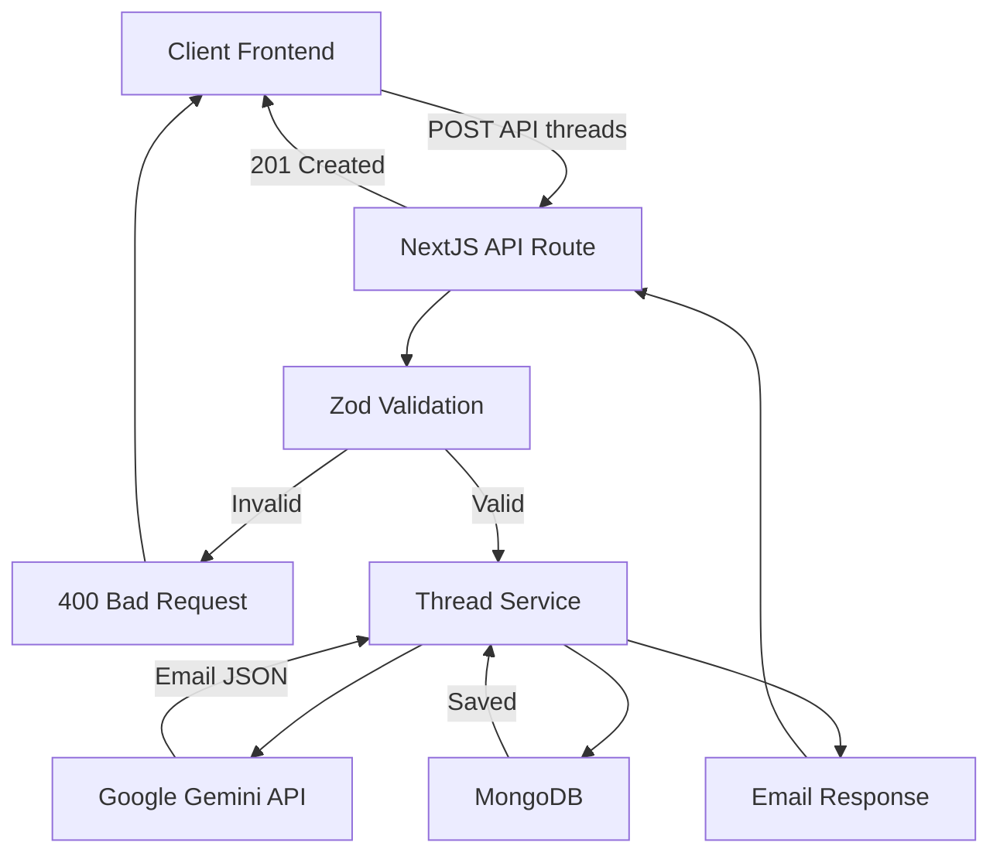

# My Email API Project 🚀

Hi! This is my AI Email Generator backend API. I built this to help people write emails faster using AI. It uses Next.js and MongoDB to save all the data. It's really cool because it remembers the emails you already sent and can reply to them!

## What it uses:
- Next.js (TypeScript)
- MongoDB to save the emails
- Google Gemini AI (super smart!)
- Mongoose and Zod

## How to run my project on your computer:
1. First, download or clone my code.
2. Open your terminal and type:
   ```
   npm install
   ```
3. Make a file named `.env.local` inside the folder and paste this. You need your own keys!
   ```env
   MONGODB_URI=your_mongo_db_url_here
   GEMINI_API_KEY=your_google_ai_key_here
   ```
4. Run the code:
   ```
   npm run dev
   ```

## Routes you can test
I used Postman to test these out:

- **Create a new email:** `POST /api/threads`
  Send JSON with a `prompt` (what the email is about), `recipientName`, and `tone`.
- **See all emails:** `GET /api/threads`
- **Reply to an email:** `POST /api/threads/:id/reply`
  (Replace `:id` with your actual thread ID from the database) and send it a `replyInstruction`.

## Why I built this:
Sometimes I get stuck trying to figure out what to say in an email, and remembering the whole conversation gets confusing. I wanted to build an API that saves the entire conversation so the AI can write super accurate replies for me automatically. Plus, I really wanted to practice building APIs with Next.js and MongoDB!

## Things I want to add later (Improvements):
- Make it faster so I don't have to wait for the AI to reply.
- Add some limits so nobody spams my API and uses up my AI credits.
- Save the emails securely so it's safer.

Thanks for checking out my project!  I learned a lot about APIs, databases, and prompting AI while making it.

##  High-Level Architecture




## How to run it with Docker!
If you know how to use Docker, I also made it ready for containers!
1. Build the image:
   ```bash
   docker build -t my-email-api .
   ```
2. Run it (don't forget to put your real keys!):
   ```bash
   docker run -p 3000:3000 -e GEMINI_API_KEY="your_ai_key" -e MONGODB_URI="your_db_url" my-email-api
   ```
